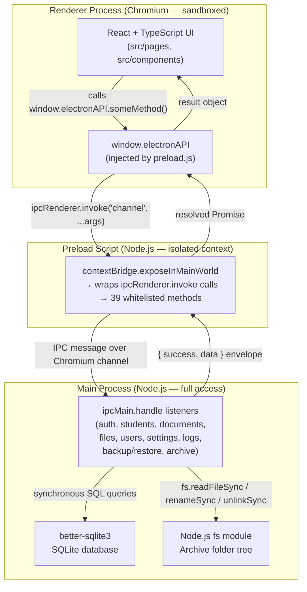
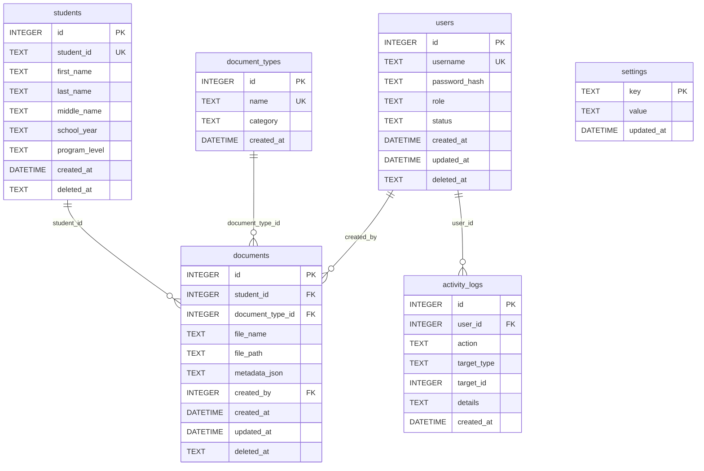
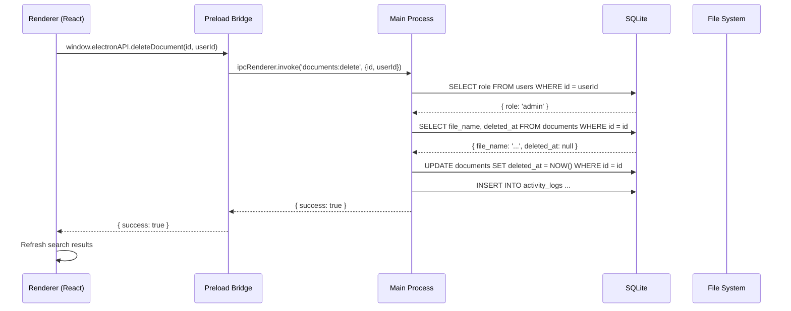
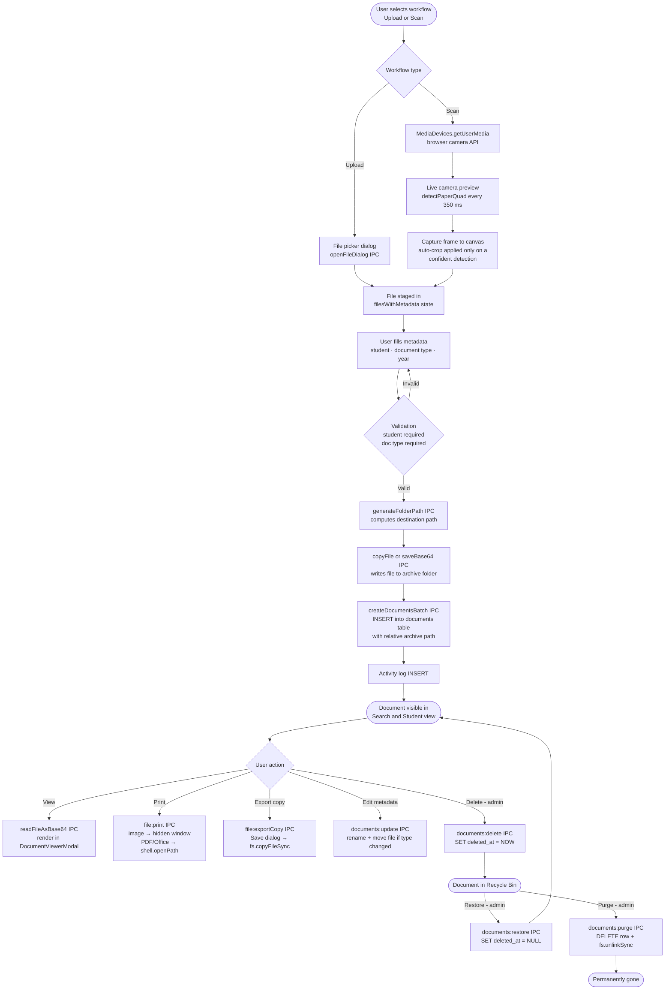

# AdZU Registrar Document Archiving System

**A fully offline, secure desktop application for the Ateneo de Zamboanga University Registrar's Office to digitize, organize, archive, and retrieve student records.**

[](https://www.typescriptlang.org/)
[](https://reactjs.org/)
[](https://www.electronjs.org/)
[](https://www.sqlite.org/)
[](LICENSE)

---

## Table of Contents

1. [System Purpose](#1-system-purpose)
2. [Architecture Overview](#2-architecture-overview)
3. [Technology Stack & Rationale](#3-technology-stack--rationale)
4. [Project Structure](#4-project-structure)
5. [Data Storage & File Paths](#5-data-storage--file-paths)
6. [Database Schema](#6-database-schema)
7. [IPC Communication Reference](#7-ipc-communication-reference)
8. [Role-Based Access Control](#8-role-based-access-control)
9. [Document Archiving Lifecycle](#9-document-archiving-lifecycle)
10. [Scanner & Image Processing Pipeline](#10-scanner--image-processing-pipeline)
11. [Soft-Delete Recycle Bins](#11-soft-delete-recycle-bins)
12. [Backup & Restore](#12-backup--restore)
13. [Installation & Setup](#13-installation--setup)
14. [Running the Application](#14-running-the-application)
15. [Building for Production](#15-building-for-production)
16. [Known Limitations & Implementation Notes](#16-known-limitations--implementation-notes)
17. [Potential Defense Questions & Answers](#17-potential-defense-questions--answers)
18. [Source Files Inspected](#18-source-files-inspected)

---

## 1. System Purpose

The AdZU Registrar Document Archiving System replaces the paper-based filing workflow at the Ateneo de Zamboanga University Registrar's Office with a structured digital archive. All documents are **strictly student-centric**: every archived file is associated with a student record and classified under one of the defined student document types (Transcript of Records, Form 137, Birth Certificate, Clearance, Certificate, Student Form, Application Form, Diploma).

The application runs entirely on a local Windows machine. It requires **no internet connection, no cloud account, and no server infrastructure**. The database and all archived files are stored on the local file system inside the operating system's per-user application-data directory.

**Key design goals verified in the source code:**

| Goal | Implementation |
|---|---|
| Fully offline | All assets bundled locally; OpenCV WASM embedded as a data URI; fonts loaded from `@fontsource` packages |
| No raw Node.js in renderer | `contextIsolation: true`, `nodeIntegration: false`, renderer communicates exclusively through the `contextBridge` API |
| Audit trail | Every mutating operation writes a row to `activity_logs` |
| Data safety on deletion | Soft-delete with recycle bin for both students and documents; permanent purge requires a separate explicit admin action |
| Password security | `bcryptjs` with cost factor 10; no plaintext passwords stored anywhere |

---

## 2. Architecture Overview

The application is built on the standard Electron **Main / Renderer / Preload** three-process model. The three layers are strictly separated and communicate only through the IPC bridge.



### Why this separation matters

The Chromium renderer process that runs the React UI is sandboxed. It cannot import Node.js modules and has no direct access to the file system or the database. All privileged operations — reading files, running SQL queries, checking user roles — run exclusively in the Main process, which enforces authorization before acting. The `preload.js` bridge defines the exact surface area of what the renderer *may request*; anything not listed there is unreachable from the UI.

---

## 3. Technology Stack & Rationale

### Verified package versions (from `package.json`)

| Package | Version | Role | Architectural rationale |
|---|---|---|---|
| **Electron** | 28.1 | Desktop shell | Provides Chromium renderer + Node.js main process in a single distributable; enables file-system access, native dialogs, and offline operation without a web server |
| **React** | 18.2 | UI library | Component model enables isolated, reusable UI pieces with predictable state management; the unidirectional data-flow pattern maps cleanly onto the IPC request/response cycle |
| **TypeScript** | 5.3 | Type system | Strict mode (`"strict": true`, `noUnusedLocals`, `noUnusedParameters`) catches interface mismatches between the preload bridge, IPC handlers, and React components at compile time, not at runtime |
| **Vite** | 5.0 | Build tool | Sub-second hot-module replacement in development; produces a minified single-bundle output in `dist/` for the packaged app |
| **Tailwind CSS** | 4.0-beta | Styling | Utility classes eliminate a separate stylesheet abstraction layer; co-location of style and structure in `.tsx` files simplifies maintenance |
| **React Router** | 6.21 | Client-side routing | Hash-free `BrowserRouter` works within Electron's Chromium renderer without a server; routes are protected at the component level and in `App.tsx` |
| **better-sqlite3** | 9.2 | SQLite driver | Synchronous API eliminates callback/Promise complexity for database operations inside IPC handlers; significantly faster than `node-sqlite3` for the read-heavy query patterns in this application |
| **bcryptjs** | 2.4 | Password hashing | Pure-JavaScript implementation; no native compilation needed, which avoids the `NODE_MODULE_VERSION` mismatch that plagues native modules when Electron's Node.js version differs from the system Node.js |
| **archiver** | 7.0 | Backup creation | Streaming ZIP creation with configurable compression; used to bundle database + archive folder |
| **adm-zip** | 0.6 | Backup extraction | Synchronous ZIP extraction used during the restore flow |
| **lucide-react** | 1.44 | Icons | Tree-shakeable SVG icon set; unused icons are excluded from the production bundle |
| **jscanify** | 1.4.3 (dev) | Document scanning | OpenCV-based paper-contour detection; copied as a local static asset at build time so no network fetch occurs at runtime |
| **@fontsource/dm-sans** | 5.3 | Body typography | Self-hosted font; no Google Fonts CDN call |
| **@fontsource/space-mono** | 5.3 | Monospace typography | Self-hosted font; used for file names and code-like data |

### Key trade-offs

**Electron vs. a web app:** Electron's bundle size (≈ 200 MB packaged) is the primary trade-off. The gain is native file-system access, SQLite integration, native dialogs, and the ability to run with zero server infrastructure — requirements that cannot be met by a browser-only application.

**better-sqlite3 (synchronous) vs. asynchronous drivers:** All IPC handlers in Electron main are already asynchronous from the renderer's perspective (they return Promises via `ipcRenderer.invoke`). Inside the main process, synchronous SQLite queries are simpler, faster, and avoid the concurrency edge cases that would arise from mixing async database calls with Electron's event loop. The trade-off is that a long query blocks the main process; the current query patterns (single-record lookups, small paginated selects) make this acceptable.

**SQLite vs. a full RDBMS:** SQLite stores the entire database in a single file, which is ideal for a single-user desktop application. It survives moving the machine or restoring from a backup ZIP without reconfiguring a server. The limitation is that concurrent write access from multiple processes is not supported — irrelevant here because `better-sqlite3` opens a single connection.

---

## 4. Project Structure

```
registrar-archiving-system/
│
├── electron/
│   ├── main.cjs          # Startup only: createWindow, database init + archive
│   │                     # migrations, shutdown hooks, registerAllIpc()
│   ├── paths.cjs         # userData / database path anchors (require-time side effects)
│   ├── window.cjs        # getMainWindow / setMainWindow — the single window reference
│   ├── preload.js        # Preload bridge: 39 contextBridge-exposed methods
│   ├── db/
│   │   ├── connection.cjs   # The one better-sqlite3 handle, initializeDatabase(),
│   │   │                    # closeDatabase(), the doc_academic_year() SQL function
│   │   └── migrations.cjs   # Idempotent runMigrations() for existing databases
│   ├── services/
│   │   ├── authz.cjs             # isAdmin(userId) — re-reads the role from the DB
│   │   ├── archivePaths.cjs      # getArchiveRoot, validateAndResolvePath,
│   │   │                         # resolveArchivePath, toArchiveRelative
│   │   ├── archiveMigrations.cjs # migrateDocumentTypeFolders, migrateToRelativePaths
│   │   ├── folderNaming.cjs      # PROGRAM_FOLDERS, sanitizers, folder/file names,
│   │   │                         # pickCollisionFreeFileName
│   │   ├── backup.cjs            # isSafeArchiveTarget, resolveArchiveDir,
│   │   │                         # inspectBackupDatabase, removeDatabaseSidecars
│   │   ├── pickedFiles.cjs       # sessionPickedFiles — the Set of dialog-picked paths
│   │   └── studentQueries.cjs    # Pure SQL builders for student search/listing
│   └── ipc/
│       ├── index.cjs             # registerAllIpc() — requires every domain module
│       ├── auth.ipc.cjs          # auth:login
│       ├── users.ipc.cjs         # users:*
│       ├── students.ipc.cjs      # students:* (incl. recycle bin)
│       ├── documents.ipc.cjs     # documents:* (search, update, batch, delete, restore, purge)
│       ├── documentTypes.ipc.cjs # documentTypes:*
│       ├── files.ipc.cjs         # file:* (copy, open, show, read, print, export)
│       ├── images.ipc.cjs        # image:saveBase64
│       ├── folders.ipc.cjs       # folders:generatePath
│       ├── dialogs.ipc.cjs       # dialog:openFile / openDirectory
│       ├── settings.ipc.cjs      # settings:get / set
│       ├── logs.ipc.cjs          # logs:add / getRecent
│       ├── dashboard.ipc.cjs     # dashboard:getStats
│       └── archive.ipc.cjs       # archive:changeDirectory / checkIntegrity
│
├── src/                  # Renderer process (React + TypeScript)
│   ├── App.tsx           # Root component: auth state, session storage, routing
│   ├── main.tsx          # React DOM mount point
│   ├── vite-env.d.ts     # Vite client type declarations
│   │
│   ├── assets/
│   │   └── adzu-seal.png # University seal (window icon + branding)
│   │
│   ├── components/
│   │   ├── Layout.tsx             # Sidebar navigation, logout button
│   │   ├── ImageEditor.tsx        # Crop/rotate/warp modal, page detection
│   │   ├── ImageEditor.css        # Editor overlay styles
│   │   ├── ConfirmDialog.tsx      # Reusable confirmation modal
│   │   ├── DocumentViewerModal.tsx# Document preview + edit + print modal
│   │   └── ui/
│   │       ├── EmptyState.tsx     # Empty-state placeholder component
│   │       ├── PageHeader.tsx     # Standardised page heading with eyebrow
│   │       ├── Pagination.tsx     # Page-number controls
│   │       ├── SortHeader.tsx     # Sortable table column header
│   │       └── Toast.tsx          # Toast notification system (context + hook)
│   │
│   ├── constants/
│   │   ├── image.ts       # IMAGE_QUALITY = 0.92 (JPEG export quality)
│   │   ├── pagination.ts  # Review-page size and other list defaults
│   │   └── scanner.ts     # SCANNER_CONFIG: intervals and analysis max sides
│   │
│   ├── features/
│   │   └── import-scanner/        # The Import / Scan workflow, extracted from the
│   │                              # former single ImportScanner page component
│   │       ├── components/
│   │       │   ├── ImportScannerPage.tsx   # Page state + orchestration
│   │       │   ├── WorkflowPicker.tsx      # Upload / Scan choice
│   │       │   ├── WorkflowBanner.tsx      # Current-step guidance banner
│   │       │   ├── StepFileAcquisition.tsx # Files list + camera scanning step
│   │       │   ├── AccessRestricted.tsx    # Non-admin placeholder view
│   │       │   ├── CameraPanel.tsx         # Camera settings, auto-crop toggle
│   │       │   ├── CameraPreview.tsx       # Video element + detection overlay
│   │       │   ├── CaptureActions.tsx      # Capture / Finish buttons
│   │       │   ├── ScannedQueue.tsx        # Captured batch list
│   │       │   ├── SessionStudentPicker.tsx# Session-wide student selection
│   │       │   ├── DocumentStudentField.tsx# Per-document student field
│   │       │   ├── AddStudentModal.tsx     # Create a student inline
│   │       │   ├── DocumentNavCard.tsx     # Document stepper
│   │       │   ├── DocumentDetailsForm.tsx # Type / year / remarks metadata form
│   │       │   ├── ReviewTable.tsx         # Pre-save review grid
│   │       │   ├── BatchResultsList.tsx    # Per-document save results
│   │       │   ├── SavingOverlay.tsx       # In-progress save overlay
│   │       │   ├── ImportActionBar.tsx     # Back / next / save actions
│   │       │   └── ImageEditorModal.tsx    # Hosts the shared ImageEditor
│   │       └── lib/
│   │           ├── cameraErrors.ts      # getUserMedia error → message mapping
│   │           ├── documentValidation.ts# Required-field validation rules
│   │           ├── editableImages.ts    # Which queue items can be edited
│   │           ├── liveOutline.ts       # drawLiveOutline overlay rendering
│   │           ├── queueHelpers.ts      # Queue insert / replace / remove
│   │           ├── studentSearch.ts     # Client-side student filtering
│   │           └── workflowLabels.ts    # Step labels and titles
│   │
│   ├── pages/
│   │   ├── Login.tsx        # Authentication form
│   │   ├── Dashboard.tsx    # Stats + recent documents table (role-aware)
│   │   ├── Students.tsx     # Student directory + student recycle bin
│   │   ├── Search.tsx       # Document search + document recycle bin
│   │   ├── ImportScanner.tsx# One-line re-export of features/import-scanner
│   │   ├── Settings.tsx     # Users, document types, archive, backup
│   │   ├── ActivityLog.tsx  # Audit log viewer
│   │   └── Help.tsx         # Inline help and feature documentation
│   │
│   ├── styles/
│   │   └── global.css     # Tailwind v4 config, CSS custom properties,
│   │                      # .surface-card, .label-caps, .focus-ring, .mono
│   │
│   ├── types/
│   │   ├── index.ts        # Shared domain types (User, Student, ArchiveDocument…)
│   │   ├── electron.d.ts   # ElectronAPI interface — typed contract for the bridge
│   │   └── jscanify.d.ts   # Type stubs for jscanify + OpenCV globals
│   │
│   └── utils/
│       ├── cameraCapabilities.ts # Camera capability helpers
│       ├── cn.ts              # clsx + tailwind-merge helper
│       ├── debounce.ts        # Debounce helper used by search inputs
│       ├── error.ts           # Shared error helpers
│       ├── format.ts          # formatDate, formatTimestamp (Asia/Manila TZ)
│       ├── imageProcessing.ts # Manual rectangular crop (canvas)
│       ├── jscanifyScanner.ts # jscanify lazy-load, detectPaperQuad, extract
│       └── permissions.ts     # DOCUMENT_ACTION_PERMISSIONS constant + helper
│
├── tests/                # Vitest suites (dev-only; never packaged)
│   ├── features/import-scanner/lib/  # cameraErrors, documentValidation,
│   │                                 # editableImages, queueHelpers,
│   │                                 # studentSearch, workflowLabels
│   ├── electron/services/studentQueries.test.ts  # the .cjs SQL builders
│   ├── utils/            # format.test.ts, debounce.test.ts
│   └── helpers/fixtures.ts  # Shared Student / DocumentType / file fixtures
│
├── public/
│   └── scanner/            # Generated at install time — do not edit
│       ├── opencv.js       # OpenCV.js with WASM embedded as a data URI
│       └── jscanify.js     # jscanify browser build
│
├── scripts/
│   └── prepare-scanner-assets.mjs  # Copies jscanify assets from node_modules
│                                    # to public/scanner/ (run by postinstall)
│
├── database/               # Legacy path — app migrates DB to userData on first run
│   └── registrar_archive.db
│
├── dist/                   # Vite production build output (gitignored)
├── release/                # electron-builder packaged installers (gitignored)
│
├── index.html              # Vite HTML entry point
├── package.json
├── tsconfig.json           # Renderer TypeScript config (strict mode)
├── tsconfig.node.json      # Tooling TypeScript config (vite.config.ts)
├── vite.config.ts          # Vite: React plugin, Tailwind, @ alias, base './'
├── vitest.config.ts        # Test config: @ alias, node environment, tests/ glob
├── eslint.config.mjs       # Flat ESLint config — every rule is set to "warn"
├── .prettierrc.json        # Style: no semi in TS, single quotes, .cjs keeps semi
├── .prettierignore         # node_modules, dist, release, public/scanner, *.md, …
├── REFACTOR_NOTES.md       # Running refactor decision log (not part of the app)
├── REFACTOR_SMOKE_TEST.md  # Manual smoke-test checklist for the refactor
├── INSTALL_AND_RUN.cmd     # Windows one-click setup script (requests UAC elevation)
└── README.md               # This file
```

---

## 5. Data Storage & File Paths

### Database location

The SQLite database is stored **outside** the application installation folder so it survives application reinstalls and updates:

```
Windows: C:\Users\<username>\AppData\Roaming\adzu-registrar-archive\database\registrar_archive.db
```

This path is resolved at runtime via Electron's `app.getPath('userData')`. On first launch the code checks for a legacy database at `<project_root>/database/registrar_archive.db` and migrates it to the `userData` path automatically.

> **Important:** The database file is a standard SQLite file. It is **not encrypted**. Access is protected by operating-system file permissions (the file sits inside the current user's `AppData` folder, which is inaccessible to other Windows user accounts by default).

### Archive (document files) location

Scanned images and uploaded documents are stored on the local file system in an **archive directory**. The default location is:

```
Windows: C:\Users\<username>\AppData\Roaming\adzu-registrar-archive\Archive\
```

This default can be changed in Settings → Archive Location. The configured path is stored in the `settings` table under the key `archive_directory`.

### Archive folder structure

Documents are organised into a hierarchy that mirrors the physical filing convention of the Registrar's Office:

```
<ArchiveRoot>/
└── <Program Folder>/           # e.g. "College Student Records"
    └── <First Letter>/         # e.g. "D"
        └── DELA CRUZ, Juan M. (2019-2020)/
            ├── Transcript of Records (TOR)/
            │   └── Transcript of Records (TOR).jpg
            ├── Form 137/
            │   └── Form 137.jpg
            └── Birth Certificate/
                └── Birth Certificate.jpg
```

Supported program-folder mappings (defined in `PROGRAM_FOLDERS` in `electron/services/folderNaming.cjs`):

| `program_level` value | Folder name |
|---|---|
| `College` | `College Student Records` |
| `Graduate School` | `Graduate Student Records` |
| `Medicine` | `Medical Student Records` |
| `Law` | `Law Student Records` |

If a student's `program_level` is not one of these four values, the system refuses to file a document for that student and displays an actionable error message.

### Path storage in the database

`documents.file_path` stores paths **relative to the archive root** (e.g., `College Student Records\D\DELA CRUZ, Juan (2019-2020)\Form 137\Form 137.jpg`). Legacy absolute paths from older database versions are resolved transparently by `resolveArchivePath()` and rewritten to relative form by the `migrateToRelativePaths()` startup migration. This means the entire archive folder can be moved to a new drive and re-pointed in Settings without breaking any stored links.

---

## 6. Database Schema

The current schema is created by `initializeDatabase()` in `electron/db/connection.cjs` and kept up to date by the idempotent `runMigrations()` function in `electron/db/migrations.cjs`, which runs on every startup. The schema below reflects the **current live structure** after all migrations.



### Table notes

**`users`**
- `role` is constrained to `'admin'` or `'user'` via a `CHECK` constraint.
- `status` is constrained to `'active'` or `'inactive'`.
- `deleted_at` implements soft-delete: the row is retained for audit-trail integrity (the `activity_logs.user_id` foreign key remains valid) and login is blocked by the `status = 'active'` check in `auth:login`.

**`students`**
- `student_id` is nullable (`TEXT UNIQUE`). Many historical records have no student ID number.
- `school_year` and `program_level` are required at create/update time by the application layer even though the schema column is nullable (the nullable constraint was needed to survive the table-rebuild migration from older schemas).
- `deleted_at` implements soft-delete into the Student Recycle Bin.

**`document_types`**
- `category` is constrained to `'student'`, `'administrative'`, `'financial'`, `'audit'`, or `'other'`.
- All seeded document types use `category = 'student'`. The migration drops any non-student types that have no linked documents.

**`documents`**
- `student_id` is nullable (foreign key to `students.id`) because documents were historically allowed without a student association. The current application layer enforces a student requirement for all new documents.
- `metadata_json` stores supplementary fields (academic year, remarks) as a JSON string. A custom SQLite scalar function `doc_academic_year()` is registered at connection time to extract the year safely inside queries, avoiding `json_extract()` failures on malformed JSON.
- `deleted_at` implements soft-delete into the Document Recycle Bin. All active-document queries include `WHERE d.deleted_at IS NULL`.
- Index `idx_documents_deleted` on `deleted_at` is created by migration to speed up recycle-bin queries.
- Index `idx_documents_created` on `created_at DESC` is created at schema initialization.

**`activity_logs`**
- `user_id` is a foreign key to `users.id`. Because users are soft-deleted (never `DELETE`d), this reference always remains valid.
- Timestamps are stored using SQLite's `strftime('%Y-%m-%dT%H:%M:%fZ','now')`, which produces ISO 8601 UTC strings. Display formatting back to Philippine Standard Time (`Asia/Manila`) is handled in `src/utils/format.ts` using `Intl.DateTimeFormat`.

**`settings`**
- Key-value store. The only key used at runtime is `archive_directory`.

### Indexes

| Index name | Table | Column(s) | Purpose |
|---|---|---|---|
| `idx_documents_created` | `documents` | `created_at DESC` | Dashboard recent-documents query |
| `idx_documents_deleted` | `documents` | `deleted_at` | Recycle bin queries |

---

## 7. IPC Communication Reference

All renderer→main communication uses `ipcRenderer.invoke` (request-response). There are no `ipcMain.on` / `ipcRenderer.send` one-way messages. Every handler returns an envelope:

```ts
// Success
{ success: true, ...data }

// Failure
{ success: false, error: string }
```

The preload bridge exposes **39 methods** across these namespaces:

| Namespace | Methods | Admin-only |
|---|---|---|
| `auth` | `login` | — |
| `students` | `getAll`, `search`, `getById`, `create`, `update`, `delete`, `getFilterOptions`, `getDeleted`, `restore`, `purge` | create, update, delete, getDeleted, restore, purge |
| `documents` | `search`, `delete`, `update`, `getDeleted`, `restore`, `purge` | delete, update, getDeleted, restore, purge |
| `documentTypes` | `getAll`, `create`, `delete` | create, delete |
| `file` | `copy`, `openExternal`, `showInFolder`, `readAsBase64`, `readPickedAsBase64`, `print`, `exportCopy` | exportCopy |
| `users` | `getAll`, `create`, `updateStatus`, `delete` | all |
| `settings` | `get`, `set` | set |
| `dialog` | `openFile`, `openDirectory` | — |
| `logs` | `add`, `getRecent` | getRecent (add is also admin-only) |
| `dashboard` | `getStats` | — |
| `image` | `saveBase64` | — |
| `documents` (batch) | `createBatch` | yes |
| `folders` | `generatePath` | — |
| `archive` | `changeDirectory`, `checkIntegrity` | both |
| `backup` | `create`, `restore` | both |



---

## 8. Role-Based Access Control

### Roles

Two roles are defined in the database `CHECK` constraint and enforced by every privileged IPC handler via the `isAdmin(userId)` helper in `electron/services/authz.cjs`:

```javascript
async function isAdmin(userId) {
  if (!userId) return false;
  const user = getDb().prepare('SELECT role FROM users WHERE id = ?').get(userId);
  return user && user.role === 'admin';
}
```

The `userId` passed through every IPC call is cross-referenced against the database on every request. A renderer-supplied claim of `role: 'admin'` is never trusted — the role is always re-read from the database in the main process.

### Permission matrix

| Feature | Administrator | Regular Staff |
|---|---|---|
| View Dashboard | ✅ Full view (stats + recent docs) | ✅ Read-only view (counts only) |
| Search Documents | ✅ View, edit, delete (soft), export | ✅ View, print only |
| Browse Students | ✅ View, create, edit, delete (soft) | ✅ View only |
| Document Recycle Bin | ✅ Open, restore, purge | ❌ Not visible |
| Student Recycle Bin | ✅ Open, restore, purge | ❌ Not visible |
| Import / Scan | ✅ Full workflow | ❌ Route blocked |
| Settings (all tabs) | ✅ Full access | ❌ Route blocked |
| Activity Log | ✅ Full access | ❌ Route blocked |
| Export file copy | ✅ | ❌ |
| Print document | ✅ | ✅ |

Route-level blocking is implemented in `App.tsx`: admin-only routes (`/import`, `/settings`, `/logs`) are rendered only when `user.role === 'admin'`. However, route guards in the renderer are a UX convenience only; every IPC handler re-validates the role independently.

The client-side permission helper in `src/utils/permissions.ts` declares which roles may trigger each document action button. This governs which buttons the UI renders — it does **not** replace backend enforcement.

---

## 9. Document Archiving Lifecycle



### File-naming and collision avoidance

When a document is filed, `pickCollisionFreeFileName()` in `electron/services/folderNaming.cjs` scans the destination folder on the actual file system. The first file uses the plain document-type name (e.g., `Form 137.jpg`). Subsequent files in the same folder receive a numeric suffix: `Form 137 (2).jpg`, `Form 137 (3).jpg`, and so on. This prevents overwrites without involving a sequence column in the database.

---

## 10. Scanner & Image Processing Pipeline

The scanner feature uses **jscanify 1.4.3** (OpenCV.js-based) to perform perspective correction on camera-captured images. The entire pipeline runs in the Chromium renderer — no main-process involvement is needed until the final file-write step.

### Asset loading (fully offline)

```
npm install
  └── prepare-scanner-assets.mjs runs (postinstall hook)
      ├── copies node_modules/jscanify/src/opencv.js  → public/scanner/opencv.js
      └── copies node_modules/jscanify/src/jscanify.js → public/scanner/jscanify.js
```

OpenCV.js has its WASM binary embedded as a base64 data URI inside `opencv.js`. This means **zero network requests** are needed at runtime, and the scanner works on `file://` URLs (packaged Electron build).

### Load sequence (`jscanifyScanner.ts`)

```
initScanner() called on first camera use
  1. Inject <script src="scanner/opencv.js"> if not already present
  2. Wait for cv.onRuntimeInitialized (WASM compile)
  3. Inject <script src="scanner/jscanify.js">
  4. Construct new jscanify() → stored in module-level `scanner` variable
  Repeat calls share the same Promise; a failed attempt resets it for retry
```

### Live detection (`ImportScannerPage.tsx`)

Every **350 ms** (`SCANNER_CONFIG.LIVE_DETECT_INTERVAL_MS`), `runLiveDetection()` copies the current video frame onto a scratch canvas downscaled to a max side of 640 px (`LIVE_ANALYSIS_MAX_SIDE`), runs `detectPaperQuad()` on it, and paints the result through `drawLiveOutline()` (`src/features/import-scanner/lib/liveOutline.ts`) so the overlay tracks the page in real time. A confident detection sets `documentFound`; a detection that returns a quad without enough confidence sets `edgesUncertain` instead, and the preview labels it as uncertain.

### Capture and auto-crop (`handleCapturePhoto`)

Capture runs entirely in the page — the editor is not opened automatically:

1. The full-resolution frame is drawn onto a canvas and exported as JPEG at `IMAGE_QUALITY`.
2. **With auto-crop on** and the scanner ready, that canvas is re-detected with `detectPaperQuad(canvas, { maxSide: SCANNER_CONFIG.LIVE_ANALYSIS_MAX_SIDE })` — the same 640 px analysis size as the live outline, so the capture decision matches the overlay the user was just shown.
3. Only a **confident** detection is applied: `extractPaperDataUrl()` perspective-warps the page and the queue item is saved as that cropped result (`croppedPage = true`).
4. Any other outcome — detection off, not ready, no quad, low confidence, a failed extraction or a thrown error — keeps the **full frame as framed**. A failed detection never costs the user the capture.
5. The frame is added to the batch queue and the camera stream stays live for the next page.

**Edit** (the queue's Edit action) opens `ImageEditorModal` → `ImageEditor`, where the page can be re-detected and cropped by hand. Detection inside the editor analyses at the larger `CAPTURE_ANALYSIS_MAX_SIDE` (1600 px), and its two detection buttons (`runAutoCrop`, `handleShowCorners`) both call `runDetection(false)`: the detected corners — or a centred inset box when nothing plausible was found — are offered as draggable handles rather than cropped automatically. The warp is only applied on an explicit Apply, so an unsure detection cannot silently cut the image.

This editor-vs-capture size difference (640 at capture, 1600 in the editor) is recorded as a follow-up in `REFACTOR_NOTES.md`.

### Quality

All JPEG exports use `IMAGE_QUALITY = 0.92` (`src/constants/image.ts`). This is a high-quality setting appropriate for archival documents that will later be printed or reviewed.

### Limitations

- **Only image files** (JPG, PNG, GIF) can be cropped or rotated. PDFs and Office files are archived as-is.
- Auto-crop works best when the document lies on a contrasting background. The `detectPaperQuad()` function validates the detected quadrilateral (minimum area 5% of frame, corner angles between 40° and 140°, each side at least 5% of the frame's longer dimension) and returns `null` if the contour is implausible.

---

## 11. Soft-Delete Recycle Bins

Both students and documents use a soft-delete pattern. Deletion sets `deleted_at` to the current UTC timestamp; the row and its physical file (for documents) are preserved. Permanent removal requires a separate explicit purge action.

### Student Recycle Bin

| Operation | IPC channel | Table effect | File effect |
|---|---|---|---|
| Delete | `students:delete` | `SET deleted_at = NOW()` | None |
| Restore | `students:restore` | `SET deleted_at = NULL` | None |
| Purge | `students:purge` | `DELETE FROM students` | None (blocked if documents exist) |

A student cannot be permanently purged while linked documents exist. The handler checks `COUNT(*) FROM documents WHERE student_id = ?` and returns an error if the count is non-zero.

### Document Recycle Bin

| Operation | IPC channel | Table effect | File effect |
|---|---|---|---|
| Delete | `documents:delete` | `SET deleted_at = NOW()` | None — file preserved |
| Restore | `documents:restore` | `SET deleted_at = NULL` | None |
| Purge | `documents:purge` | `DELETE FROM documents` | `fs.unlinkSync` on resolved path |

The purge handler validates the file path through `resolveArchivePath()` before deletion to prevent path traversal. If `resolveArchivePath()` returns `null` (path escapes the archive root), the file is skipped with a warning logged to the console, and the database record is still deleted.

### Active-document query guard

Every query that fetches active documents includes the explicit filter `d.deleted_at IS NULL`. This guard is present in `documents:search`, `dashboard:getStats`, and the student-folder document list. The index `idx_documents_deleted` ensures this filter does not degrade query performance.

---

## 12. Backup & Restore

### Create backup (`backup:create`)

1. Admin-only.
2. Prompts for a `.zip` save path using `dialog.showSaveDialog`.
3. Uses `db.backup(tempPath)` — SQLite's built-in online backup API — to create a consistent snapshot of the live database without locking it.
4. Bundles the snapshot and the entire `Archive` folder into a ZIP using `archiver`.
5. Verifies the ZIP write completes before returning success; cleans up the temp DB file in `finally`.

### Restore backup (`backup:restore`)

1. Admin-only.
2. Extracts the ZIP to a temp folder.
3. **Validates the extracted database** with `db.pragma('integrity_check')` and confirms required tables exist before touching any live data.
4. Snapshots the current live database to a safety temp file.
5. Closes the live database connection, replaces `registrar_archive.db`, reopens the connection, and runs `runMigrations()` (the backup may pre-date the current schema).
6. Replaces the `Archive` folder, displacing the previous one with a `.pre-restore-<stamp>` suffix before overwriting; if the copy fails, the displaced folder is restored.
7. Logs success/failure to `activity_logs`.

> **Data safety note:** A failed restore rolls back to the pre-restore database snapshot. The file-system and database operations are not fully atomic (they cannot be — SQLite transactions do not span the file system), but the ordering is designed to ensure either the old state or the new state is intact, never a partial mix.

---

## 13. Installation & Setup

### Prerequisites

| Requirement | Version | Notes |
|---|---|---|
| **Node.js** | 18 LTS or later | [nodejs.org](https://nodejs.org/) |
| **npm** | 9+ | Included with Node.js |
| **Python** | 3.x | Required by `node-gyp` for native module compilation |
| **Windows Build Tools** | — | See below |

**Windows Build Tools** (required to compile `better-sqlite3` for Electron):

```powershell
# Option A — Visual Studio Build Tools (recommended)
# Download from https://visualstudio.microsoft.com/downloads/
# Select "Desktop development with C++" workload

# Option B — npm global helper (older method, may not work on Node 18+)
npm install --global windows-build-tools
```

### Step-by-step setup

```cmd
# 1. Clone or extract the project
cd registrar-archiving-system-updatedDatabase

# 2. Install all dependencies (also copies jscanify assets via postinstall)
npm install

# 3. Rebuild better-sqlite3 for Electron's Node.js version
npm run rebuild
```

> If step 3 fails, the error message from `main.cjs` on startup will include
> `NODE_MODULE_VERSION mismatch` — this is the rebuild issue. Re-run `npm run rebuild`.

### One-click Windows setup

```cmd
INSTALL_AND_RUN.cmd
```

This script requests UAC elevation, pre-creates the `%APPDATA%\adzu-registrar-archive` and `Archive` subdirectories (preventing permission errors on first run), runs `npm install`, runs `npm run rebuild`, then starts the application.

---

## 14. Running the Application

### Development mode

```cmd
npm run dev
```

This uses `concurrently` to start the Vite dev server (`http://localhost:5173`, with hot-module replacement) and Electron simultaneously. Electron loads from the Vite dev server. DevTools open automatically in dev mode.

### Default credentials

| Role | Username | Password |
|---|---|---|
| Administrator | `admin` | `admin123` |
| Regular Staff | `user` | `user123` |

> **Change these passwords immediately** after first login in a production deployment via Settings → User Accounts → the account's menu.

### Type-check only (no build)

```cmd
npm run typecheck
```

Runs `tsc --noEmit`. TypeScript is configured with strict mode, `noUnusedLocals`, and `noUnusedParameters`.

### Testing and tooling

Dev-only — none of these run during `npm run build`, and no lint or test output is bundled into the app.

| Command | What it does |
|---|---|
| `npm test` | `vitest run --passWithNoTests` — the suites under `tests/` (currently 9 files / 109 tests: the pure `src/features/import-scanner/lib/*` helpers, `src/utils/format.ts`, `src/utils/debounce.ts`, and the pure SQL builders in `electron/services/studentQueries.cjs`). Renderer code is imported through the same `@` alias Vite uses; the `.cjs` service is `require`d directly. |
| `npm run lint` | Flat ESLint config (`eslint.config.mjs`). **Every rule is set to `warn`**, so it reports problems and still exits 0 — it cannot fail a build. The current warnings are dominated by `react-hooks/rules-of-hooks` on the three admin-gated pages. |
| `npm run typecheck` | `tsc --noEmit` over `src/` (see above). |
| `npm run format` | `prettier --write` **with no default path** — it deliberately does nothing (and writes nothing) unless you pass explicit file arguments, e.g. `npm run format -- src/utils/debounce.ts`. `*.md` is ignored via `.prettierignore`. |

Test files live in the top-level `tests/` folder only — never under `src/` or `electron/`, because `electron/**/*` is packaged into the installer.

---

## 15. Building for Production

### Verify the build compiles

```cmd
npm run build
```

Runs `tsc` then Vite. Output goes to `dist/`. This does not package Electron.

### Windows installer (NSIS)

```cmd
npm run build:win
```

Runs `npm run build` then `electron-builder --win`. Output: `release/AdZU Registrar Archive Setup <version>.exe`.

The installer is configured in `package.json` under the `build` key:

```json
{
  "appId": "com.adzu.registrar.archive",
  "productName": "AdZU Registrar Archive",
  "win": { "target": ["nsis"], "icon": "src/assets/adzu-seal.png" },
  "files": ["dist/**/*", "electron/**/*", "node_modules/**/*", "package.json"],
  "directories": { "output": "release" }
}
```

Note: `node_modules/jscanify` and `node_modules/canvas` are excluded from the packaged build because their source files are already copied to `public/scanner/` at build time.

### macOS / Linux

```cmd
npm run build:mac
npm run build:linux
```

These are included in `package.json` scripts but have not been tested on the target platform. The `better-sqlite3` native module will need to be rebuilt for the target Electron version on each platform.

---

## 16. Known Limitations & Implementation Notes

| Area | Status | Detail |
|---|---|---|
| **Database encryption** | ❌ Not implemented | The SQLite file is unencrypted. It is protected only by OS user-level file permissions (`AppData\Roaming`). SQLite encryption (e.g., SQLCipher) was not implemented. |
| **Archive file encryption** | ❌ Not implemented | Archived images and documents are plain files on the file system. |
| **Session expiry** | ❌ Not implemented | The session (stored in `sessionStorage`) persists until the window is closed or the user manually logs out. There is no idle timeout. |
| **Concurrent users** | ❌ Not supported | `better-sqlite3` holds a single connection. Multiple Electron windows or instances would contend for the same database file. The application is designed for single-user desktop operation. |
| **Password change** | ✅ Implemented | Admins can set user passwords via `users:create` and `users:updateStatus`; there is no self-service password-change UI for the current user. |
| **Student ID uniqueness** | ✅ Enforced | `student_id TEXT UNIQUE` in the schema; the application returns a friendly duplicate error before hitting the constraint. |
| **program_level values** | ⚠️ Hardcoded | Only `College`, `Graduate School`, `Medicine`, and `Law` map to archive folders. A student with a different `program_level` cannot have documents filed under them. |
| **PDF/Office editing** | ❌ Not supported | Only image files (JPG, PNG, GIF) pass through the crop/rotate editor. PDFs and Office files are archived and opened with the OS default viewer. |
| **Audit log write access** | ⚠️ Admin-only write | `logs:add` requires admin. Frontend activity logging from non-admin users (e.g., login events) is done through internal main-process writes, not through `logs:add`. |
| **Metadata fields** | ⚠️ Partially removed | The schema previously included `metadata_fields` and `document_type_fields` tables for per-type custom fields. These tables were dropped by migration. `metadata_json` in documents still stores `academic_year` and `remarks`; the dynamic-field UI code in `ImportScanner.tsx` references `dynamicFieldConfigs` but with no table backing it. |

---

## 17. Potential Defense Questions & Answers

**Q: Why Electron instead of a web application hosted on a server?**
A: The primary requirement was fully offline operation with no server infrastructure. A web application would require a back-end server, a database server, and network availability. Electron embeds Chromium and Node.js in a single distributable, giving the application access to the local file system and SQLite without any external dependencies or network connectivity.

**Q: Why SQLite instead of PostgreSQL or MySQL?**
A: SQLite stores its entire database in a single file, making it ideal for a single-user desktop application. There is no server process to install or configure, no connection pooling, and backups are simply file copies. The entire database travels inside the backup ZIP. The limitations — no concurrent write access from multiple processes, limited column-type enforcement — are irrelevant for this use case.

**Q: How does the application prevent the renderer from accessing arbitrary files or executing arbitrary SQL?**
A: `contextIsolation: true` and `nodeIntegration: false` in `BrowserWindow.webPreferences` mean the Chromium renderer has no access to Node.js APIs. The `preload.js` bridge uses `contextBridge.exposeInMainWorld` to inject only 39 specific named methods into `window.electronAPI`. The renderer cannot call `ipcRenderer` directly, cannot import `fs` or `better-sqlite3`, and cannot invoke any IPC channel not listed in the preload bridge. All SQL queries in the main process use parameterised `db.prepare(...).run(...)` statements, preventing SQL injection.

**Q: How does the system prevent a regular-staff user from performing admin actions by sending a forged IPC message?**
A: Every privileged IPC handler calls `isAdmin(userId)`, which performs a fresh database read: `SELECT role FROM users WHERE id = ?`. The renderer sends the `userId` from `sessionStorage`, but the role is never read from the renderer — it is always re-fetched from the database in the main process. A forged role claim in the IPC argument has no effect.

**Q: What happens to the database if the application crashes mid-write?**
A: `better-sqlite3` uses WAL (Write-Ahead Logging) mode implicitly for concurrent-safe snapshots (used in `db.backup()`). SQLite itself is ACID-compliant: an interrupted write either completes or rolls back on the next connection open. The migration sidecar files (`-wal`, `-shm`, `-journal`) are cleaned up explicitly during the backup restore flow.

**Q: How is the archive folder structure kept consistent with the database?**
A: Document paths are stored relative to the `archive_directory` setting. On startup, `migrateToRelativePaths()` rewrites any legacy absolute paths. `migrateDocumentTypeFolders()` moves files that were stored flat in the student folder into their document-type subfolder. `resolveArchivePath()` is used for every file operation: it validates the path is within the archive root and handles both absolute legacy paths and relative current paths transparently.

**Q: How does the soft-delete recycle bin prevent accidentally exposing deleted documents in search results?**
A: The `documents:search` IPC handler hardcodes `d.deleted_at IS NULL` as the first condition in its WHERE clause (not a user-supplied filter, not optional). The `dashboard:getStats` handler independently applies the same filter. The `documents:getDeleted` handler explicitly queries `WHERE d.deleted_at IS NOT NULL`, so the two result sets are mutually exclusive.

**Q: How is the scanner guaranteed to work without internet access after packaging?**
A: The `prepare-scanner-assets.mjs` script (run by `npm postinstall`) copies `opencv.js` and `jscanify.js` from the pinned `jscanify@1.4.3` `node_modules` package into `public/scanner/`. These files are bundled into the Electron package under `dist/scanner/`. `opencv.js` has its WASM binary embedded as a base64 data URI, so there is no `.wasm` file fetch and no CDN call at runtime. The Vite config uses `base: './'` so the asset URL resolves correctly under `file://` in a packaged build.

---

## 18. Source Files Inspected

The following files were read directly to verify every claim in this README:

| File | Purpose |
|---|---|
| `electron/main.cjs` | Startup order only: `createWindow()`, database init + archive migrations, shutdown hooks, `registerAllIpc()` |
| `electron/paths.cjs` | userData database path, legacy-database copy, `PROJECT_ROOT` / `PRELOAD_PATH` anchors |
| `electron/window.cjs` | Single `BrowserWindow` reference shared with the IPC modules |
| `electron/db/connection.cjs` | The one `better-sqlite3` handle, `initializeDatabase()`, `registerDbFunctions()` (`doc_academic_year`), `closeDatabase()` |
| `electron/db/migrations.cjs` | `runMigrations()` — the idempotent schema migrations |
| `electron/services/folderNaming.cjs` | `PROGRAM_FOLDERS`, folder/file sanitizers, `pickCollisionFreeFileName()` |
| `electron/services/archivePaths.cjs` | `getArchiveRoot()`, `validateAndResolvePath()`, `resolveArchivePath()`, `toArchiveRelative()` |
| `electron/services/archiveMigrations.cjs` | `migrateDocumentTypeFolders()`, `migrateToRelativePaths()` |
| `electron/services/authz.cjs` | `isAdmin(userId)` |
| `electron/services/studentQueries.cjs` | Pure SQL builders behind student search / listing |
| `electron/ipc/*.ipc.cjs` | One domain per file; the `ipcMain.handle` bodies |
| `electron/preload.js` | Exact list of 39 exposed bridge methods |
| `src/App.tsx` | Auth state, session storage, route guards |
| `src/features/import-scanner/components/ImportScannerPage.tsx` | Scanner orchestration, `runLiveDetection`, `handleCapturePhoto` |
| `src/components/ImageEditor.tsx` | `findQuad` / `runDetection` — editor-side detection and corner handling |
| `src/constants/scanner.ts` | `SCANNER_CONFIG` (intervals, `LIVE_ANALYSIS_MAX_SIDE`, `CAPTURE_ANALYSIS_MAX_SIDE`) |
| `src/pages/ImportScanner.tsx` | Confirms it is a one-line re-export |
| `vitest.config.ts`, `eslint.config.mjs`, `.prettierrc.json`, `.prettierignore` | Tooling behaviour described in §14 |
| `src/types/index.ts` | Domain type definitions (User, Student, ArchiveDocument, DocumentType…) |
| `src/types/electron.d.ts` | TypeScript-typed IPC contract |
| `src/utils/jscanifyScanner.ts` | Scanner asset loading, `initScanner`, `detectPaperQuad`, `extractPaperDataUrl` |
| `src/utils/format.ts` | Date/timestamp formatting, `Asia/Manila` timezone |
| `src/utils/permissions.ts` | `DOCUMENT_ACTION_PERMISSIONS` matrix |
| `src/constants/image.ts` | `IMAGE_QUALITY = 0.92` |
| `src/pages/Dashboard.tsx` | Role-aware stat display |
| `scripts/prepare-scanner-assets.mjs` | Asset copy logic, offline guarantee |
| `package.json` | Package versions, scripts, electron-builder config |
| `vite.config.ts` | `base: './'`, plugins, path alias |
| `tsconfig.json` | Strict mode settings |
| `INSTALL_AND_RUN.cmd` | UAC elevation, folder pre-creation, setup sequence |

### Claims that could not be independently verified

- **macOS / Linux build correctness:** `build:mac` and `build:linux` scripts exist in `package.json` but no macOS or Linux environment was available to run them.
- **Camera device compatibility:** The scanner uses the standard `MediaDevices.getUserMedia` browser API. Compatibility with specific camera hardware is outside the scope of source-code inspection.
- **Performance under large datasets:** Query plans were not profiled. The pagination (`LIMIT`/`OFFSET`) and `idx_documents_created` / `idx_documents_deleted` indexes are present, but performance with tens of thousands of records was not measured.

---

*Built for the Ateneo de Zamboanga University Registrar's Office.*
*AdZU Registrar Document Archiving System — Capstone Project.*
